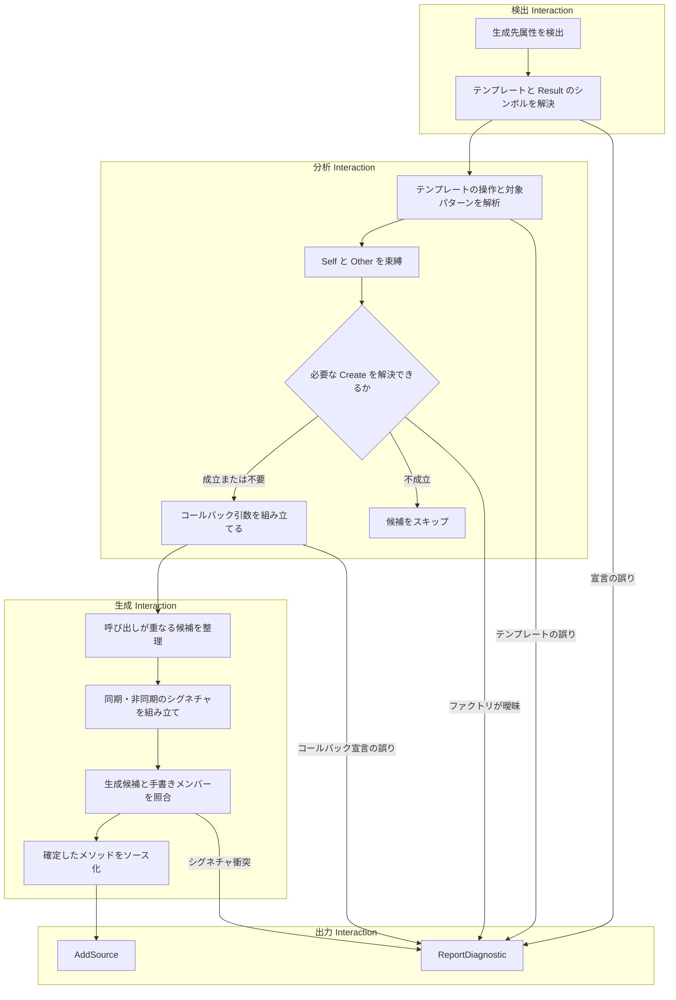

# Result API ジェネレーターの設計とロードマップ

[ResultAPI の試作](../../InteractionFlow.Core/ResultAPI/ResultTemplate.cs) は、Result の形と拡張メソッドの分岐を C# で宣言し、型の組ごとに同期・`Task`・`ValueTask` の API を生成する案です。`Self` は拡張メソッドの受け手、`Other` は変換先を表します。生成先は [同期](../../InteractionFlow.Core/ResultAPI/ResultExtensions.cs)、[Task](../../InteractionFlow.Core/ResultAPI/ResultExtensionsAsync.cs)、[ValueTask](../../InteractionFlow.Core/ResultAPI/ResultExtensionsValueAsync.cs) の三つの `partial` クラスです。定型処理を生成し、個別の振る舞いを持つ API は手書きで補完します。

## 生成の前提

- **対象型。** `ResultAPITarget` が指定する型を束縛し、テンプレートが使うメンバーを検証します。`IsSuccess` にはアクセス可能な `bool` のインスタンスプロパティを要求します。生成先は `ResultAPIExtension` で検出します。
- **Result の状態。** `default(Result)` は成功です。値付きの `default` は未初期化で、`IsSuccess` の参照時に `ResultException` を送出します。生成メソッドはこの例外を伝播させます。初期化済みの成功分岐では `Value`、失敗分岐では `Error` と `ErrorValue` が非 null です。 [Result の定義](../../InteractionFlow.Core/ResultAPI/Result.cs)
- **コールバックの引数。** `Self` のプロパティに付いた `ResultAPICallbackArgument` で、成功・失敗の区分と引数順を指定します。 [コールバック引数の属性](../../InteractionFlow.Core/ResultAPI/Attributes/ResultAPICallbackArgumentAttribute.cs)
- **公開範囲。** 初版の生成器は Core ビルド専用とし、属性・テンプレートは内部化します。試作の `InteractionFlow.Core.ResultAPI` と既存の `InteractionFlow.Core.Entities` は別の名前空間に同名型を持ちます。まず試作側で生成を検証し、公開 API のシグネチャと呼び出し側を新しい Result 契約に合わせて書き直します。`HasValue`、`HasError`、`WithoutValue`、`ThrowIfError`、暗黙変換などの実行時契約は Core の手書きコードが担います。

## 生成する API の成立条件

1. **対象パターンを選ぶ。** `ResultAPITarget` の型引数名を分解し、同じ指定内の同名を同じメソッド型変数に束縛します。`twoWay` は方向付きの候補を二つに展開します。テンプレートと生成先の指定を束縛し、同じ型の組を一つにまとめます。同じ組に 2 引数形式の指定が含まれる場合は、`Self` のみを参照するテンプレートにも適用します。`Self` のみを参照する `Resolve` / `IfSuccess` / `IfError` / `IfElse` では、属性のコンストラクターが 2 引数形式の `Self → Self` を選びます。`Other` を参照する `Then` / `ThenError` には、`Self → Self` を含む方向付き候補を適用します。
2. **各テンプレートが使用するファクトリを解決する。** 束縛後の `Self` と `Other` が同一型なら、`Other.CreateSuccess(self)` と `Other.CreateFailure(self)` は `self` をそのまま返します。型が異なる場合、`Other.CreateSuccess(self)` は成功分岐、`Other.CreateFailure(self)` は失敗分岐のプロパティを使います。ファクトリはアクセス可能な `static` メソッドで、戻り型が具体化した `Other` に一致する必要があります。各引数を、その分岐の属性が付いた `Self` のアクセス可能な同名インスタンスプロパティに対応付けます。述べた分岐の契約を適用した後、型の同一性または暗黙の参照変換と null 許容を照合します。たとえば `ResultException → Exception` は成立し、独立した `TError → RError` は不成立です。0 引数の `CreateSuccess()` は成立します。`default` の補充、キャスト、利用者定義の暗黙変換は初版では行いません。
3. **必要な Create が成立しない候補はスキップする。** `Then` は `CreateFailure`、`ThenError` は `CreateSuccess` だけを判定します。通常の不成立は診断を出さずに同期・非同期ともその候補を省きます。ファクトリが複数等しく適合する場合は宣言元に診断を出します。新しい `TError` の組み立てなど、定型ルールの外で意味を定義できる処理は手書きで追加します。
4. **コールバック引数を組み立てる。** `Self` のプロパティを分岐ごとに並べ、各プロパティの型と並び順をデリゲートに反映します。

### コールバック引数の順序

該当する分岐の `ResultAPICallbackArgument` が付いた、アクセス可能な読み取りプロパティを選びます。`index` の指定がある引数は昇順に並べます。同じ値の引数と、指定済みの引数に続く未指定分は、それぞれプロパティ名の序数順に並べます。該当プロパティがなければ引数なしのデリゲートを組み立てます。

デリゲートの型と呼び出しは同じ順序を使います。初版では組み込みの Result 3 型について分岐ごとの非 null 契約を適用し、それ以外の型では宣言上の null 許容を使います。

| `Self` | 成功側の引数名 | 失敗側の引数名 |
| --- | --- | --- |
| `Result` | `()` | `(Error)` |
| `Result<T>` | `(Value)` | `(Error)` |
| `Result<T, TError>` | `(Value)` | `(Error, ErrorValue)` |

`Result<T, TError>` の失敗側には `Error` と `ErrorValue` があるため、失敗コールバックは `ResultException` と `TError` を受け取り、`onError(self.Error!, self.ErrorValue!)` と呼び出します。呼び出し側のラムダは任意の引数名を使えます。

### 現在のターゲット宣言を当てはめた結果

`E` と `F` は型付きエラー、`T` と `R` は成功値の型変数です。別名の変数は独立した型引数として扱います。表の「生成」は、コールバック引数の組み立てと呼び出し検証の前に残る候補を示します。

| `Self → Other` | `Then` | `ThenError` |
| --- | --- | --- |
| `Result → Result` | 生成 | 生成 |
| `Result<T> → Result<T>` | 生成 | 生成 |
| `Result<T, E> → Result<T, E>` | 生成 | 生成 |
| `Result<T> → Result<R>` | 生成 | `R` の成功値がない |
| `Result<T> → Result<R, F>` | `F` のエラー値がない | `R` の成功値がない |
| `Result<T, E> → Result<R, F>` | `F` のエラー値がない | `R` の成功値がない |
| `Result<T, E> → Result<T, F>` | `F` のエラー値がない | 生成 |
| `Result<T, E> → Result<R, E>` | 生成 | `R` の成功値がない |
| `Result → Result<T>` | 生成 | `T` の成功値がない |
| `Result<T> → Result` | 生成 | 生成 |
| `Result → Result<T, E>` | `E` のエラー値がない | `T` の成功値がない |
| `Result<T, E> → Result` | 生成。例外を保持 | 生成。値なし成功へ変換 |
| `Result<T> → Result<T, E>` | `E` のエラー値がない | 生成 |
| `Result<T, E> → Result<T>` | 生成。例外を保持 | 生成 |

ファクトリ照合後は `Then` 9 件、`ThenError` 8 件、`Self` のみの 4 メソッドが各 3 件の計 29 候補です。型付きから型なしへの `Then` では `Error` が残り、`ErrorValue` は変換先の契約に従って落ちます。 [ターゲット宣言](../../InteractionFlow.Core/ResultAPI/ResultTemplate.cs#L8)

### 同じ呼び出しを受けるオーバーロード

次の 3 候補は、対応する右欄の候補と同時に公開すると、同じ型の Result を明示的に返すラムダで `CS0121` になります。右欄は同じ型も受け取れるため、両方の候補が成立したときは左欄を省きます。この規則を非同期展開の前に適用し、同期版の期待値を 26 件とします。

| 省く候補 | 残す候補 |
| --- | --- |
| `Then` の `Result<T> → Result<T>` | `Result<T> → Result<R>` |
| `Then` の `Result<T, E> → Result<T, E>` | `Result<T, E> → Result<R, E>` |
| `ThenError` の `Result<T, E> → Result<T, E>` | `Result<T, E> → Result<T, F>` |

初版はこの 3 組に限定し、残す候補で同じ具体型を束縛したときに引数と分岐処理が等しいことを確認します。同じテンプレートで同型時の受け手返却だけが異なる場合も、覆われる候補を省きます。別の生成候補や手書きメソッドとの宣言衝突は、非同期展開後に照合します。

## ジェネレーター内の処理



4 段階を操作クラスに分け、`ResultApiGenerator.Initialize` が処理を接続します。検出・分析・生成で見つけた診断は、出力で `ReportDiagnostic` に渡します。通常の不成立では候補をスキップし、診断対象に関係しない候補は処理を続けます。

| 処理 | 実装方針 |
| --- | --- |
| 検出 | `IIncrementalGenerator` と `ForAttributeWithMetadataName` で `ResultAPIExtension` 付きの型を検出します。生成先はソース内のトップレベルの非ジェネリックな `static partial` クラスに限定します。属性引数からテンプレートを解決し、基底型をたどって `ResultAPITemplate` を確認します。テンプレート本体が同じコンパイルにあることを要求します。対象の Result 型は `ResultAPITarget` のコンストラクターに渡された型から解決します。 |
| 解析 | `ResultAPIFunc` が付いたメソッドのシグネチャと本体を Roslyn シンボルと `IOperation` で解析します。`Self.IsSuccess`、`Other.Create*`、`OnSuccess*` / `OnError*` の `Invoke` をシンボルで認識します。初版は現在の 6 テンプレートを表現できる分岐・呼び出し・`return` に対応します。対応外の構文を含む生成対象には位置付きの診断を出し、手書きで実装する処理は生成対象から外せます。 |
| 具体化 | メソッドの引数・戻り値・本体で `Self` / `Other` を使っているか判定し、必要な型の組だけを束縛します。テンプレート自身の `TResolved` も含め、公開シグネチャに現れる型変数を安定した順で列挙します。受け手を `this` 引数へ置換し、属性で選んだプロパティの順序と型を `Func` / `Action` の宣言および呼び出しに反映します。型変数が戻り値だけに現れ、通常の呼び出しで推論できない形は公開前の検証で捕捉します。 |
| 非同期展開 | 同期の成立判定を共有し、フラグに応じて受け手のみ・コールバックのみ・両方を非同期化します。`Resolve` の `TResolved` と `If*` の `Self` を含め、実際の戻り値型を包みます。 |
| 衝突判定 | 生成先ごとにメソッド名・型引数数・引数型と受け渡し方法を比較します。型引数名を宣言順の番号で正規化し、戻り型や nullable 注釈だけが異なる候補も衝突として扱います。同一宣言に帰着する候補はまとめ、実装が異なる生成候補には診断を出します。手書きメソッドの扱いは次節の規則に従います。 |
| ソース化と出力 | 生成操作が `#nullable enable` と完全修飾型名を使い、XML コメントを含む `.g.cs` を組み立てます。出力前に、生成先と同じ名前空間の型名を、その箇所で同じシンボルに解決される場合だけ短縮します。同じ確認を通過する箇所では、`System.Threading.Tasks` の型をファイルローカルの `Tasks` エイリアスで参照します。出力操作が決定的なヒント名と本文を `AddSource` に渡します。 |

Roslyn と C# の参照先は [属性を起点とする増分処理](https://learn.microsoft.com/en-us/dotnet/api/microsoft.codeanalysis.syntaxvalueprovider.forattributewithmetadataname) と [メソッドのシグネチャ](https://learn.microsoft.com/en-us/dotnet/csharp/language-reference/language-specification/basic-concepts#75-signatures-and-overloading) です。

### 操作間のデータと増分キャッシュ

- 検出・分析・生成は `InteractionResult<T>` で処理結果と診断を返します。検出対象や生成ソースがない場合は値を null とし、そこで得た診断を出力まで渡します。
- `DetectedExtension` は生成先の定義・型シンボル・対象パターンを検出から分析へ渡します。`AnalyzedExtension` は生成先・成立した候補・手書きメンバーの照合情報を分析から生成へ渡します。診断位置は別引数で渡します。
- `AnalyzedCandidate` は成立したテンプレートと型の組を表します。束縛済みの型・引数と、分岐・ファクトリ呼び出しを含むメソッド本体の断片を保持します。待機を許可された受け手・コールバック・戻り値には、分析で解決した待機可能型も保持できます。
- `GeneratedSource` はヒント名とソース本文の組です。診断を別の値として出力に渡し、位置だけが変わった場合も同じソースを再利用します。
- 生成先の partial クラスを増分キャッシュの単位にします。`AnalyzedExtension` は候補と手書きメンバーの一覧を要素順で比較します。生成操作内では、メソッド名・型引数の個数・正規化した引数型と受け渡し方法をキーに照合します。
- 操作クラスと増分ステップの境界は個別に決めます。シンボルと `SemanticModel` は同じコンパイル内で使い、増分ステップには値比較できる結果を渡します。配列は要素と順序を比較します。まず Roslyn のキャッシュを使い、解析の重複は実測を見て同一コンパイル内で再利用します。 [Roslyn のモデル設計指針](https://github.com/dotnet/roslyn/blob/main/docs/features/incremental-generators.cookbook.md#pipeline-model-design)
- `GeneratorDriver` で増分ステップを追跡し、無関係な編集後の再利用と、テンプレート・Result 型・手書きメンバーの変更が必要な出力に反映されることを確認します。

### 同期メソッドの具体化例

`Then` に `Result<T, E> → Result<R, E>` を適用すると、失敗分岐で `Error` と共有した型 `E` の `ErrorValue` をファクトリに渡せます。

```csharp
public static Result<R, E> Then<T, E, R>(
    this Result<T, E> self,
    Func<T, Result<R, E>> onSuccess)
{
    if (self.IsSuccess)
        return onSuccess(self.Value!);

    return Result<R, E>.CreateFailure(self.Error!, self.ErrorValue!);
}
```

この例の `!` は、各分岐で対応する値が非 null になる契約に基づきます。`Other` が `Result<R, F>` の場合は `F` を供給できず、メソッド本体の組み立ての前にスキップします。

### 非同期版の展開

| 生成する形 | 受け手 | コールバック | 戻り値 |
| --- | --- | --- | --- |
| 同期 | `Self` | `Func<…, TResult>` / `Action<…>` | `TResult` |
| `asyncSelf` | `Task<Self>` / `ValueTask<Self>` | 同期 | `Task<TResult>` / `ValueTask<TResult>` |
| `asyncCallback` | `Self` | `Func<…, Task<TResult>>` / `Func<…, Task>` と `ValueTask` 相当 | `Task<TResult>` / `ValueTask<TResult>` |
| 両方 | `Task<Self>` / `ValueTask<Self>` | 同じ種類の非同期コールバック | `Task<TResult>` / `ValueTask<TResult>` |

`TResult` は各テンプレートを具体化した戻り値型です。同期の生成先ではフラグにかかわらず同期版を生成します。非同期の生成先では、有効なフラグに対応する版と、両方が有効な場合の組み合わせを生成します。`awaitableFuncType` と `awaitableActionType` は、生成する `async` メソッドの戻り値に使え、待機時に型引数の値または `void` を返す必要があります。現在の Core は `Task<>` / `Task` と `ValueTask<>` / `ValueTask` を指定しています。

非同期の受け手は先頭で 1 回だけ待ち、コールバックは選ばれた分岐で 1 回だけ呼び出します。`ConfigureAwait(false)` を呼び出し、同じ結果型として待てる場合はその形を使います。それ以外は直接 `await` します。例外とキャンセルは伝播させます。`Resolve` / `IfElse` の両コールバックは同じ同期区分にそろえ、混在版は必要に応じて手書きで追加します。`Task` と `ValueTask` は `Async` / `ValueAsync` で名前を分けます。 [現行の非同期契約](../RESULT.md#非同期版)

省略可能な `ConfiguredFuncType` を指定すると、`asyncSelf` が有効な版にその型を受け手とするオーバーロードを追加します。未構築の 1 型引数の型を指定し、直接待機すると型引数の値を取り出せることを検証します。受け手をそのまま `await` するので、`.ConfigureAwait(true).ThenAsync(...)` のように呼び出し側の設定を使えます。生成メソッドの戻り値と非同期コールバックには通常の待機可能型を使います。

### 手書きコードとの共存

- 生成先の同じ `partial` クラスに、同一シグネチャで戻り型・公開性・拡張メソッドとしての宣言が整合する手書きメソッドがある場合、その候補だけを生成から外します。型制約つきや参照戻り値のメソッド、同名のプロパティなど、整合しない宣言には診断を出します。
- `Map` / `MapAsync`、`AsResult` / `AsResultAsync`、`StartAsync` に相当する機能や、値・エラーの個別変換は、必要に応じて新契約に沿ったシグネチャで手書きします。
- 別クラスにある同名拡張は候補を抑止しません。公開前に、生成・手書きの両方が見える利用側コードをコンパイルします。型を維持する `Then` / `ThenError` の呼び出し、`Task` を返すコールバックを渡した `ResolveAsync` の戻り値型、`If*` の `async` ラムダが待機されることを確認します。

## 実装ロードマップ

| 段階 | 作業 | 完了条件 |
| --- | --- | --- |
| 1. 宣言と期待値をそろえる | Result のプロパティにコールバック引数の区分と必要な並び順を設定し、Result の現行定義、ファクトリの成立表、重複する呼び出しの除外規則をテストデータにします。 | `default` の挙動、分岐ごとの非 null 契約、型付きエラーの保持・破棄、引数名と順序に期待値がある。 |
| 2. 同期版を縦に通す | Core を参照しない `netstandard2.0` のジェネレータープロジェクトを作り、Core からビルド時 Analyzer として参照します。まず `Then` の 1 パターンを検出から出力まで実装し、続けて 6 テンプレートと全ターゲットを処理します。既存 Analyzer は Roslyn 3.3.1 を参照するため、増分生成器は別プロジェクトに置き、Core ビルドを支える Roslyn の下限は実装時に確認します。 | GeneratorDriver で同期版 26 件がコンパイルできる。成立・不成立の表、手書き優先、宣言の診断を再現し、利用側の通常のラムダ呼び出しで曖昧さが出ない。 |
| 3. 非同期版を追加する | 同期版の具体化結果を使い、フラグと生成先ごとの awaitable を適用します。 | フラグ 4 通りと両 awaitable の呼び出しが型推論込みで成立し、成功・失敗の分岐、例外・キャンセル伝播、`ValueTask` の単回消費を確認できる。 |
| 4. 新しい公開 API へ移行する | 生成・手書きの双方で新契約に沿った公開シグネチャを確定し、Standard・Samples・テストの呼び出しを移行します。公開 API の差分を確認し、利用者向けに移行方法を記録します。 | 更新後の拡張呼び出し・静的呼び出し・名前付き引数が成立する。`dotnet build InteractionFlow.slnx` と `dotnet test InteractionFlow.slnx` が通り、Core の NuGet パッケージだけを参照する利用側で生成済み API を呼べる。 |

診断と生成コードのテストでは、型引数の個数違い、`twoWay`、`Self → Self` の適用範囲、名前の異なる型変数、同じファクトリに複数候補がある場合を扱います。コールバック引数については、インデックスの指定と省略が混在する場合、同じインデックス、引数なしの分岐を確認します。呼び出し側のテストではラムダ、メソッドグループ、名前付き引数と推論される戻り値型を確認します。生成器を利用側へ配布する要件が生じた時点で、属性の公開と Roslyn ホストの互換範囲を再検討します。 [Core プロジェクト](../../InteractionFlow.Core/InteractionFlow.Core.csproj)・[既存 Analyzer プロジェクト](../../InteractionFlow.Analyzers/InteractionFlow.Analyzers.csproj)
